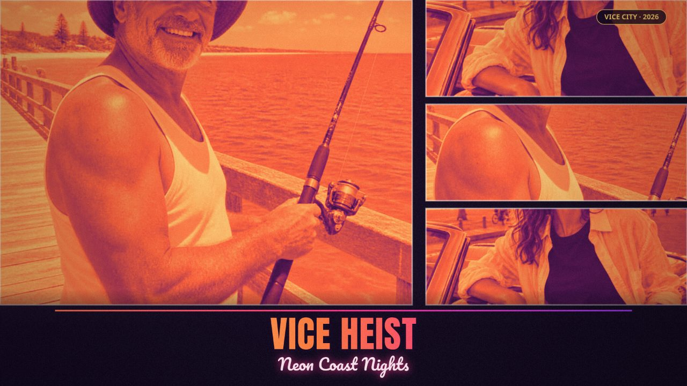

[](https://make.fun/bounty/gta6-cover-art-01?utm_source=github&utm_medium=readme&utm_campaign=gta6-cover-art-01)
[](https://make.fun/bounty/gta6-cover-art-01/leaderboard?utm_source=github&utm_medium=readme&utm_campaign=gta6-cover-art-01)
[](https://make.fun/bounty/gta6-cover-art-01?utm_source=github&utm_medium=readme&utm_campaign=gta6-cover-art-01)

# Vice Cover Studio — GTA 6 Cover Art

Turn your photos into multi-panel cover art in the style of a GTA 6 poster: bold condensed lettering, a neon script subtitle, sunset and neon colour grades, and a clean PNG export in the sizes people actually post. Built for make.fun's `gta6-cover-art-01` bounty — [Make GTA 6 Cover Art](https://make.fun/bounty/gta6-cover-art-01), $250 in USDC.



## What it does

- **6 layouts** — 4-panel grid, hero-and-three, full bleed, 9-panel grid, tilted-snapshot collage, and a story/poster split. Switch layouts any time; your photos and crops carry over.
- **5 colour grades** — Vice Sunset, Neon Coast, Golden Hour, Night Drive, and Mono Noir. Each is a true gradient map applied per panel on canvas, so shadows, mid-tones and highlights all land in the poster's palette.
- **Any photo, any panel** — upload several photos (they never leave your machine), click a photo then a panel to place it, drag a panel to reposition the photo, scroll to zoom. Fill every panel from one photo, or spread several photos across the cover. Two free sample photos are bundled under `app/samples/`.
- **Lettering** — Anton for the big condensed title (white with a black outline, or a sunset-gradient / neon-pink fill) and Pacifico for the glowing neon script subtitle. Title, subtitle and badge ribbon text are all editable.
- **Polish** — film grain and vignette toggles, undo/redo, and a live preview canvas.
- **Export** — one-click PNG at 1080×1080 (square), 1080×1350 (poster), 1920×1080 (landscape) and 1080×1920 (story).

## How it runs

Open `app/index.html` in a desktop browser, or serve it with `node serve.ts` and visit http://localhost:8080. Everything is dependency-free vanilla JavaScript + canvas, no build step, no network — every font, photo and script is a file inside `app/`.

`main.ts` (Node 22, standard library only) copies `app/` and `screenshots/` to `/output` and writes the dossier with the vendored make.fun library:

```sh
mkdir -p out && MAKEFUN_OUTPUT_DIR=out node main.ts
```

## How to use it

1. Add photos with **Add photos**, or press **Load sample photos** to try the two bundled shots.
2. Pick a **Layout** and a **Grade**.
3. Click a photo in the tray, then click a panel to place it there. Drag inside a panel to move the photo, scroll to zoom it. **Fill all panels from selected photo** spreads one photo across the cover.
4. Type your **Title**, **Subtitle** and **Badge** text; pick the title fill.
5. Choose an export size and press **Export PNG** (or one of the four size buttons).

## Files

| Path | What it is |
| --- | --- |
| `app/index.html` | Editor shell: controls, photo tray, preview canvas |
| `app/style.css` | Dark Vice City editor theme |
| `app/src/state.js` | Layouts, grades, export sizes, state + undo/redo history |
| `app/src/cover.js` | Canvas renderer: panels, gradient-map grades, lettering, grain, vignette |
| `app/src/main.js` | UI wiring: uploads, drag/zoom, controls, exports |
| `app/src/shots.js` | Fixed `?shot=` scenes used for the screenshots |
| `app/fonts/` | Anton + Pacifico (SIL OFL, texts included) |
| `app/samples/` | Two AI-made sample photos, free to use |
| `screenshots/` | 4 screenshots: landscape cover, editor, portrait cover, square cover |
| `main.ts` | Entry point: copies the app + screenshots to `/output`, writes `dossier.json` |
| `vendor/makefun-app.ts` | Vendored make.fun library (unchanged from the kit) |

## Credits

- Lettering: [Anton](https://github.com/googlefonts/AntonFont) and [Pacifico](https://github.com/google/Pacifico) — SIL Open Font License 1.1, texts in `app/fonts/`.
- Sample photos: AI-made for make.fun, free to use.
- No Rockstar Games logo, official artwork or fonts are used anywhere in this project.

## License

MIT — see LICENSE.
